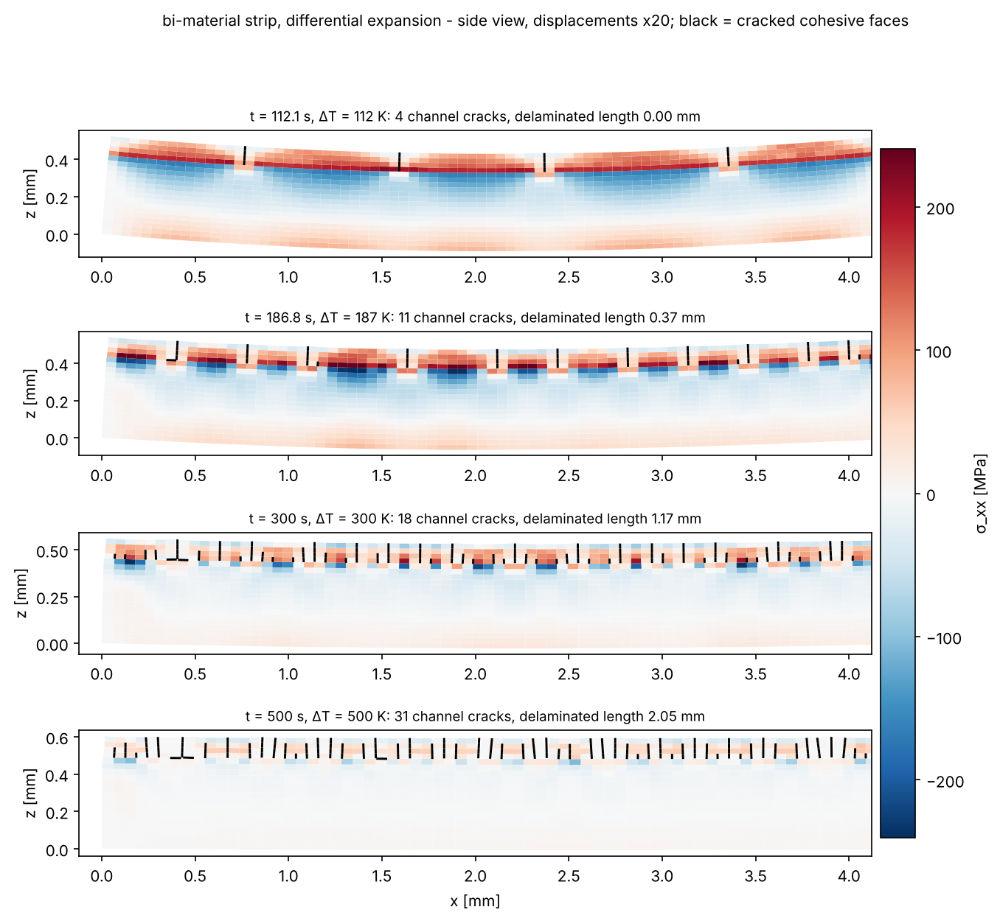
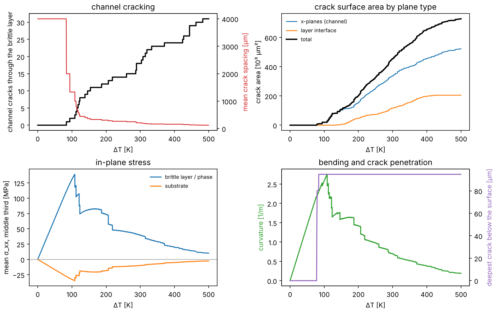
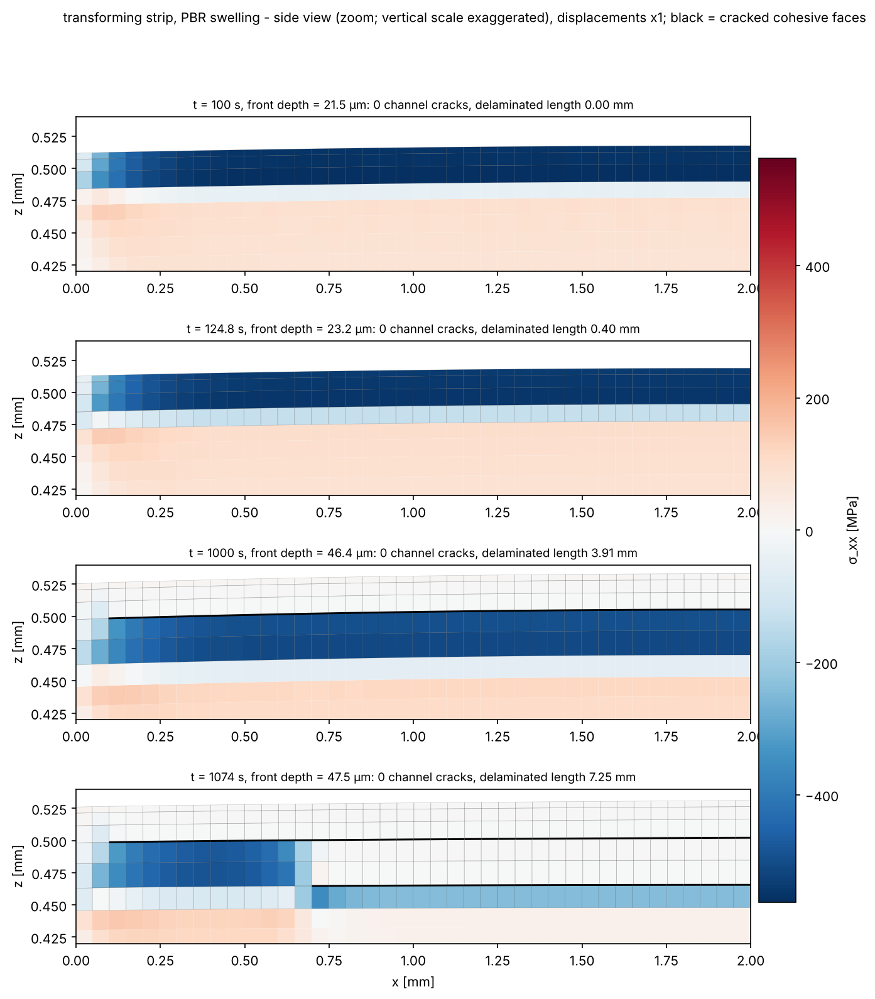
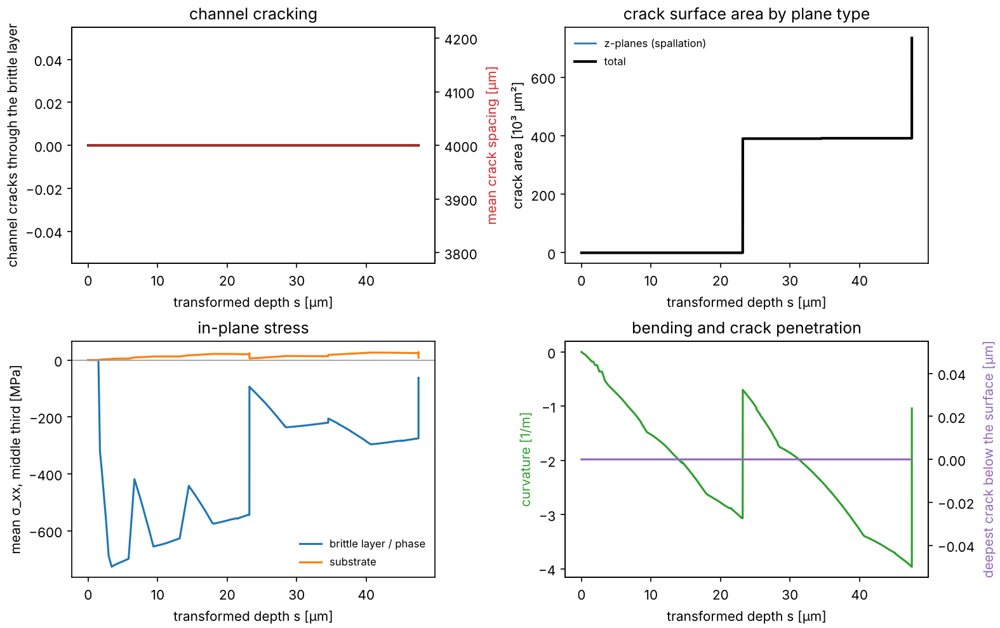
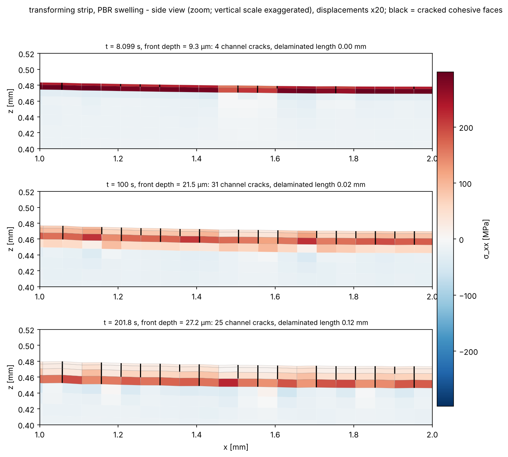

# stripcz — cohesive-zone fracture of bi-material and transforming strips

A parallel C++17 finite-element code for cracking of layered strips, built on the same stack and
approach as [cohesive-pellet-fracture](https://github.com/RizgarMella/cohesive-pellet-fracture).
That stack is cohesive-zone crack planes, Weibull-distributed strength and toughness on mesh-independent
random fields, AMG-preconditioned CG with OpenMP, viscous-regularised adaptive time stepping and MPI
ensembles. The study tooling (run directories, crack-area convergence with GCI, series planners, PySR
fit) follows [peridynamic-pellet-fracture](https://github.com/RizgarMella/peridynamic-pellet-fracture).

Two problems:

* **Series A — bi-material strip, differential expansion.**
  * A brittle, low-toughness top layer is bonded to a tougher substrate with a different thermal
    expansion coefficient.
  * Heating stretches the top layer. It channel-cracks, the cracks multiply until their spacing saturates,
    and they may kink into the interface (delamination) or penetrate the substrate.
  * The **top layer, bottom layer and interface each have their own Weibull strength and toughness
    distributions.**
  * The planned study keeps the total thickness fixed and varies the fraction of top material.
* **Series B — transforming strip, swelling.**
  * A single-material strip whose top surface converts into a more brittle phase.
  * The front advances as **s(t) = (k t)^{1/3}** (cubic law; exponent configurable).
  * The new phase swells by a chosen **Pilling–Bedworth ratio**, split between the surface-normal and
    in-plane directions. **The swelling, not a thermal mismatch, drives the stresses.**
  * The **substrate, growing phase and transformation front have separate distributions.**

> **Status.** Solver, verification tests and study planners are complete and the tests pass. The series
> themselves have **not** been run. The images below come from three small demonstration runs (see
> [Demos](#demos)). Two of them were stopped early, which the Demos section notes.

---

## Model

| Ingredient | Implementation |
|---|---|
| Geometry | strip L × W × h (x, y, z), one or more bonded layers, structured hexahedra (2×2×2 Gauss), optional grading towards the top of a layer |
| Potential cracks | zero-thickness cohesive interfaces, enabled per layer: x-planes (channel cracks), y-planes (longitudinal cracks; with x-planes they form mud-crack networks when ny > 1), z-planes (delamination / spallation at any depth), and the layer interface (always cohesive) |
| Cohesive law | penalty K, linear or exponential softening, mixed-mode effective separation (β), irreversible damage with viscous regularisation, full-penalty contact in compression, optional friction (shared with pelletcz) |
| Statistics | per zone: Weibull strength and fracture energy (own mean, modulus, threshold), on a Gaussian random field of the zone's own correlation length and seed (or per element with weakest-link scaling), strength–toughness correlation ρ; local flaws |
| Series A load | uniform temperature history; each layer has its own E, ν, α; eigenstrain α(T − T_ref) |
| Series B load | front depth s(t) = (k(t − t₀))^{1/n}. The transformed fraction is uniform within each element (the fraction of the element row behind the front), with mixed elastic constants. The eigenstrain is φ·diag(e_p, e_p, e_n), with (1 + e_p)²(1 + e_n) = PBR and e_p = a·e_n (a = 1 isotropic, a ≪ 1 for growth mostly normal to the surface) |
| Zones in B | a vertical crack-plane point uses the substrate or phase distribution; a horizontal plane with phase above and substrate below is the *front*. Points switch zone as the front passes; damage is irreversible |
| Boundary conditions | `free` (statically determinate 3-2-1 pins; the strip bends freely, pin reactions are reported), `roller_bottom`, `clamped_bottom` (rigid substrate), `clamped_end` (cantilever); `plane_strain_y` makes a one-element-wide strip represent a wide plate |
| Numerics | modified Newton with symmetric secant interface matrix and line search; PCG + smoothed-aggregation AMG (rigid-body near-nullspace); adaptive steps rejected on large damage jumps; dt ~ 2μ while cracks run; initiation approached via the failure index; load change limited per step (ΔT, or front advance ≤ half the thinnest element) |
| Parallelism | OpenMP throughout; `mpirun -n R stripcz --ensemble cases.txt` runs cases over ranks; Slurm array scripts from the planners |

### Why the transformed fraction is element-wise

A swelling strain that varies *inside* a trilinear element cannot be followed by its linear
displacement field. With a 50 % normal swelling strain this produces spurious stresses of order E·e_n,
and in testing those cracked the strip at sub-micron front depths.

The transformed volume fraction is therefore applied uniformly within each element. Row-wise constant
strains are compatible across horizontal element faces, so only the real in-plane mismatch between
phase and substrate generates stress. Grade the mesh (`layer0.grading`) so the phase is resolved by
several element rows.

---

## Build and run

```bash
cmake -S . -B build -DCMAKE_BUILD_TYPE=Release && cmake --build build -j
cd build && ctest --output-on-failure && cd ..
OMP_NUM_THREADS=4 ./build/stripcz inputs/bimaterial_strip.ini          # series A base case
OMP_NUM_THREADS=4 ./build/stripcz inputs/transforming_strip.ini        # series B base case
./build/stripcz inputs/bimaterial_strip.ini geometry.top_fraction=0.3 fracture.top.strength.weibull_modulus=10
python tools/render.py runs/bimaterial_strip --frames 3,6,9,-1         # figures (matplotlib)
```

Every input key is listed in [docs/INPUT_REFERENCE.md](docs/INPUT_REFERENCE.md). ParaView reads
`bulk.pvd`, `surface.pvd` and `cracks.pvd`.

### Outputs (run directory)

| file | content |
|---|---|
| `manifest.json` | inputs, build id, labels, derived quantities: cohesive lengths and ζ = l_cz/h per zone, transformation strains, volume-ratio check |
| `history.csv` | one row per step (units in the names), see below |
| `bulk_/surface_/cracks_NNNN.vtu` | stresses, phase fraction, layer, fragments; crack faces with damage, opening, zone, strength, toughness |
| `xplanes_NNNN.csv` | per x-plane: cracked fraction of the brittle layer or phase, crack depth, opening (crack-spacing statistics) |
| `outputs.csv`, `summary.json` | output times; final state, onset, crack area by plane type and by zone, fragment volumes (`"complete": true` only for finished runs) |

`history.csv` columns:

* **Load:** T, ΔT, front depth.
* **Crack area:** by plane type (x / y / z / layer interface) and by zone; damaged area; dissipated energy.
* **Channel cracks:** x-planes cracked through ≥ 90 % of the brittle layer, and their mean spacing.
* **Damage extent:** deepest crack below the surface; delaminated area (cracked horizontal planes).
* **Strip state:** curvature of the bottom centre line; mean σ_xx of the brittle layer and the substrate
  over the middle third; max principal stress; fragments.
* **Checks and solver effort:** pin reaction, Newton and PCG iterations.

---

## Verification

`ctest` runs `tests/test_main.cpp`:

| test | result |
|---|---|
| cohesive law: peak traction = σ_t, work of separation = G_c | < 0.1 % |
| PBR: isotropic e = PBR^{1/3} − 1; anisotropic split reproduces the volume ratio exactly | exact |
| growth law s = (k t)^{1/3} from `depth_at_time` | exact |
| zones: phase above the front, front plane, substrate below; all substrate before transformation | exact |
| Weibull per zone: mean strength of top layer and substrate; interface point count | < 0.6 % |
| fully transformed free block: extensions e_p·L and e_n·H, stress free | 0.0 % |
| **bimetal curvature** vs Timoshenko (1925), plane strain, free strip; no pin reactions | 1.2 % |

---

## Demos

Three small runs. All use 80 × 1 elements along the 4 mm strip (50 µm in-plane), plane strain across
the width, `free` supports, and Weibull fields with correlation length 30–50 µm in every zone. At 50 µm the
in-plane element size is close to the crack spacings found, so spacings here are **mesh-limited**. They
show the behaviour; the convergence study is what turns them into numbers.

### A — bi-material strip heated by 500 K (`inputs/bimaterial_strip.ini`)

**Setup.**
* Layers: 0.1 mm top layer (E = 380 GPa, α = 8×10⁻⁶ /K, σ̄_t = 150 MPa, G_c = 10 J/m², m = 6) on a
  0.4 mm substrate (E = 200 GPa, α = 17×10⁻⁶ /K, 400 MPa, 100 J/m², m = 15).
* Interface: 200 MPa, 20 J/m², m = 8.
* Mesh: 20 element rows.
* Cost: 3,718 steps, 20 min on 1 core.





**Before cracking.** The substrate expands more, so the strip bends towards the top layer. The top layer
goes into tension, while the substrate just below the interface is in compression.

**Initiation.** The first crack forms at **ΔT = 78 K** in a weak region of the top-layer field.

**Multiplication.**
* Channel cracks then multiply: 4 at 112 K, 11 at 187 K, 18 at 300 K, and **31 at 500 K**.
* The final mean spacing is 125 µm, or 1.25 h_top.
* Each new crack relaxes the stress in the segments next to it, so the curvature peaks at 2.75 /m
  (ΔT ≈ 110 K) and then falls to 0.19 /m.

**Delamination and arrest.**
* From ≈ 130 K, cracks kink into the interface. **2.05 mm of the 4 mm** interface has delaminated by
  500 K.
* No crack entered the substrate: substrate crack area is 0, and the deepest crack is 95 µm (the top
  layer's Gauss points).
* The tougher substrate arrests the channels.

**Check.** The 3-2-1 pins carried < 0.4 mN throughout, so they held the strip without loading it.

### B — transforming strip, PBR = 1.56, swelling mostly normal to the surface (`inputs/transforming_strip.ini`)

**Setup.**
* Substrate: 0.5 mm, Zr-like (E = 95 GPa).
* Transformed phase: ZrO₂-like (E = 200 GPa, σ̄ = 150 MPa, G_c = 5 J/m², m = 6).
* Front: 150 MPa, 20 J/m².
* Growth: cubic law reaching 100 µm at 10⁴ s.
* Swelling: a = 0.005, giving e_n = 0.551 and e_p = 0.0028, with (1 + e_p)²(1 + e_n) = 1.56.
* Mesh: 24 rows graded towards the surface.
* **Run length:** stopped at t = 1,074 s (front at 47.5 µm), so not the full 10⁴ s. It was 35 min on
  1 core; the bursts below need 10⁻⁴ s steps.
* The figures use true displacements and zoom onto the top 120 µm of the left half.





**Stress and bending.**
* The in-plane swelling is constrained, so the phase sits at **−400 to −700 MPa** compression.
* Neither channel cracks nor the tensile mode of series A appear.
* The strip bends away from the phase, with curvature −3 /m before the first spall.

**First spallation.**
* At a front depth of **23 µm** (t ≈ 125 s) the whole phase layer **spalls** along the plane just above
  the front.
* The spall starts at a free end (x ≈ 3.9 mm, edge peel) and runs the full length within ≈ 0.2 s.
* The released layer becomes stress free.

**Second spallation.**
* The front keeps advancing under the spalled layer, so a second compressed phase layer builds up.
* At **47 µm** it too starts to spall from the ends: delaminated length 7.25 mm, i.e. two layers across
  most of the strip.
* This repeated spalling produces a layered scale, as seen in breakaway oxidation.

### C — transforming strip, PBR = 0.995, isotropic (a tensile phase)

**Setup.** The same strip with PBR < 1: the phase *shrinks* (e = −0.17 % in every direction). Run with
`transformation.pilling_bedworth_ratio=0.995 transformation.anisotropy=1`. **Run length:** stopped at
t = 210 s (front at 27.6 µm).



**Behaviour.**
* The constrained shrinkage puts the phase in **tension** (≈ 300 MPa before cracking), so it behaves
  like series A.
* The first crack forms at a front depth of only **6.2 µm**.
* By 21.5 µm there are 31 channel cracks, about one per element, which is the mesh-limited spacing.
* As the phase thickens, some older cracks no longer reach through it, so the count of through-cracks
  drops to 25–27. They are slowly re-initiated deeper.
* Only 0.12 mm of the front has delaminated.

Reproduce (render options as used above):

```bash
./build/stripcz inputs/bimaterial_strip.ini
python tools/render.py runs/bimaterial_strip --frames 3,9,23,37 --warp 20
./build/stripcz inputs/transforming_strip.ini
python tools/render.py runs/transforming_strip --frames 1,3,20,-1 --warp 1 --xlim 0 2 --zlim 0.42 0.54
./build/stripcz inputs/transforming_strip.ini transformation.pilling_bedworth_ratio=0.995 \
    transformation.anisotropy=1 output.directory=runs/transforming_strip_pbr0995
python tools/render.py runs/transforming_strip_pbr0995 --frames 1,5,-1 --warp 20 --xlim 1 2 --zlim 0.40 0.52
```

---

## Studies

All planners write a self-contained study directory, using the same layout as the pellet projects:
`study.json`, `cases.csv`, `cases.txt` for MPI, `jobs/jobs.tsv`, a Slurm array script and a dataset card.
Each case is the base input plus overrides. Runs are resumable, and every derived table has a
`.meta.json` sidecar.

```bash
python tools/thickness_ratio_study.py plan --seeds 3 --interface-toughness 5 20 80
python tools/study_common.py run studies/ratio --parallel 2 --threads 2       # or: mpirun ... --ensemble
python tools/thickness_ratio_study.py analyze studies/ratio && python tools/thickness_ratio_study.py plot studies/ratio
```

### Series A — fixed total thickness, varying top-material fraction (`tools/thickness_ratio_study.py`)

**Design.**
* Fixed geometry: h = 0.5 mm and the same number of elements through the thickness. The interface
  always lies on a node plane, with ≥ 2 elements in the top layer.
* Top fraction f = h_top/h ∈ {0.05, 0.1, 0.2, 0.3, 0.5, 0.7}.
* Optional interface-toughness levels.
* Independent seeds for all three zone fields.
* Load: heating to ΔT = 500 K.

**Metrics.**
* Onset ΔT.
* Channel cracks vs ΔT.
* Saturated spacing, also as spacing/h_top.
* Delaminated fraction.
* Crack penetration into the substrate.
* Curvature.

**Analysis and figures.**
* Seed means, sd and bootstrap CI per level.
* Figures: onset, spacing/h_top, delamination and curvature against f; crack-count curves.

### Series B — growing brittle phase with Pilling–Bedworth swelling (`tools/transformation_study.py`)

**Design.** One factor at a time (default) or full factorial over:
* PBR ∈ {0.95, 1.28, 1.56, 1.79};
* anisotropy a ∈ {0.002, 0.005, 0.02, 0.1};
* phase toughness ∈ {2, 5, 20} J/m²;
* front toughness ∈ {5, 20, 80} J/m².

Each runs with the cubic law; `--exponents 2 3` adds parabolic growth. Phase, substrate and front each
have their own seeds.

**Metrics.**
* Critical depth at first crack.
* Channel cracks and their spacing vs depth.
* Spallation (delaminated area) vs depth.
* Crack depth into the substrate.
* Curvature and in-plane stresses.

### Mesh convergence on crack surface area (`tools/mesh_convergence.py --series A|B`)

Refines nx and the element rows together; levels nx ∈ {40, 60, 80, 120, 160}. Three families, as in
pelletcz:
* `field`: correlated fields of fixed physical length in every zone, so refinement samples the same
  material;
* `element`: per-element draws with weakest-link scaling;
* `constant`: no scatter.

Analysis:
* Crack area and channel count at load levels.
* Celik GCI on the three finest levels, with Richardson extrapolation and a seed-noise test.
* The recommended level is written to `derived/convergence.json`.

### Metamodel (`collect` → `tools/fit_pysr.py`)

Each series' `collect` writes `derived/dataset.csv`. It holds the dimensionless groups of
`tools/features.py` and a train/validation split.

Series A groups:
* Π_mis = E′|Δα|ΔT/σ_t;
* h_top/l_ch, E_t/E_b, G_c,i/G_c,t, σ_i/σ_t, m.

Series B groups:
* Π_swell = E_p′|e_p|/σ_p;
* PBR, a, s/l_ch, s/H, E_p/E_s, G_c,f/G_c,p, m.

Targets:
* spacing / thickness;
* onset stress ratio (A) or critical depth / l_ch (B);
* delaminated fraction.

`fit_pysr.py` fits PySR, scores the Pareto front on the validation split, keeps the simplest equation
within 5 % of the best, and compares with gradient boosting. Without PySR it reports the gradient-boosting
baseline only.

---

## Limitations

* **Predefined crack planes.** Cracks follow element boundaries on enabled planes; use `all` spacing.
  Inclined crack paths, such as kinking at angles other than 90°, are not represented.
* **Small strain, linear elasticity, no creep or plasticity.**
  * Growth stresses in real oxides relax by creep. The anisotropy parameter is the knob for the
    effective in-plane mismatch.
  * Large normal swelling strains (e_n ≈ 0.5 for PBR = 1.56, a = 0.005) are treated as small strains.
    They are stress-free in the normal direction, so this mainly affects the geometry.
* **No buckling.** Compressed thin phases spall here by edge peel and shear, never by buckling.
* **Element-wise transformation.** The front is resolved to the element-row size; the onset depth
  converges with the grading.
* **MPI parallelises cases, not one solve.**

## References

* Timoshenko S. (1925) Analysis of bi-metal thermostats. J. Opt. Soc. Am. 11, 233–255.
* Pilling N.B., Bedworth R.E. (1923) The oxidation of metals at high temperatures. J. Inst. Metals 29, 529–591.
* Hutchinson J.W., Suo Z. (1992) Mixed mode cracking in layered materials. Adv. Appl. Mech. 29, 63–191.
* Evans A.G., Hutchinson J.W. (1995) The thermomechanical integrity of thin films and multilayers. Acta Metall. Mater. 43, 2507–2530.
* Thouless M.D. (1991) Cracking and delamination of coatings. J. Vac. Sci. Technol. A 9, 2510–2515.
* Williamson R.L., Knoll D.A. (2009) Simulating dynamic fracture in oxide fuel pellets using cohesive zone models. SMiRT-20, paper 1775 (the cohesive-zone approach and viscous regularisation).
* Turon A. et al. (2007) Eng. Fract. Mech. 74 (cohesive-zone mesh size); Celik I.B. et al. (2008) J. Fluids Eng. 130 (GCI); Vaněk P. et al. (1996) Computing 56 (smoothed-aggregation AMG); Cranmer M. (2023) arXiv:2305.01582 (PySR).
